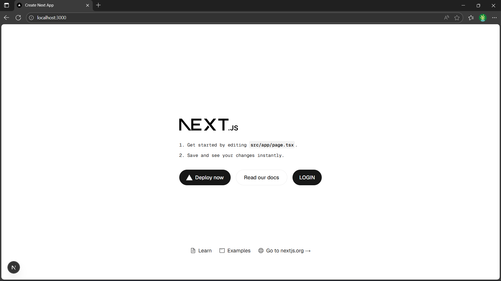
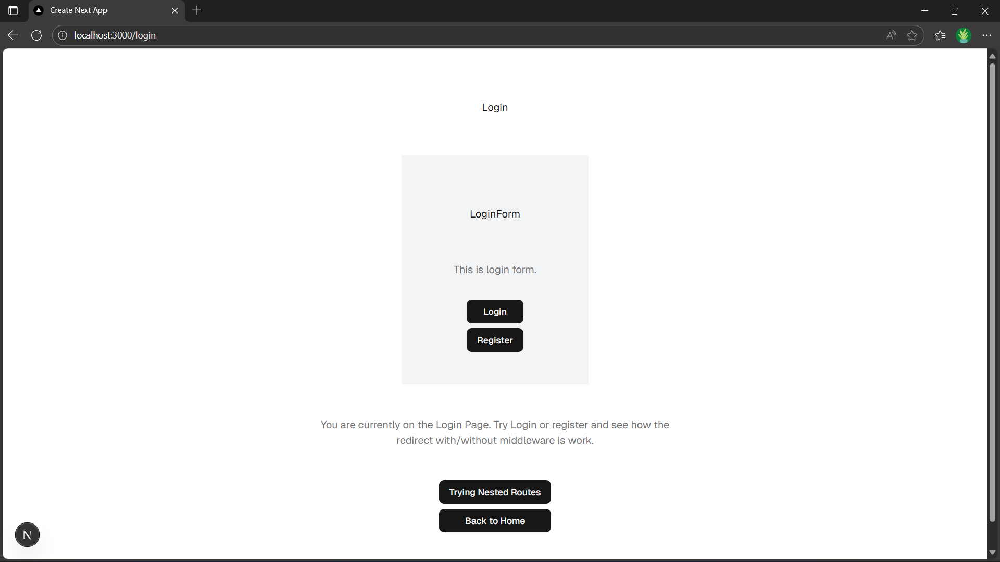
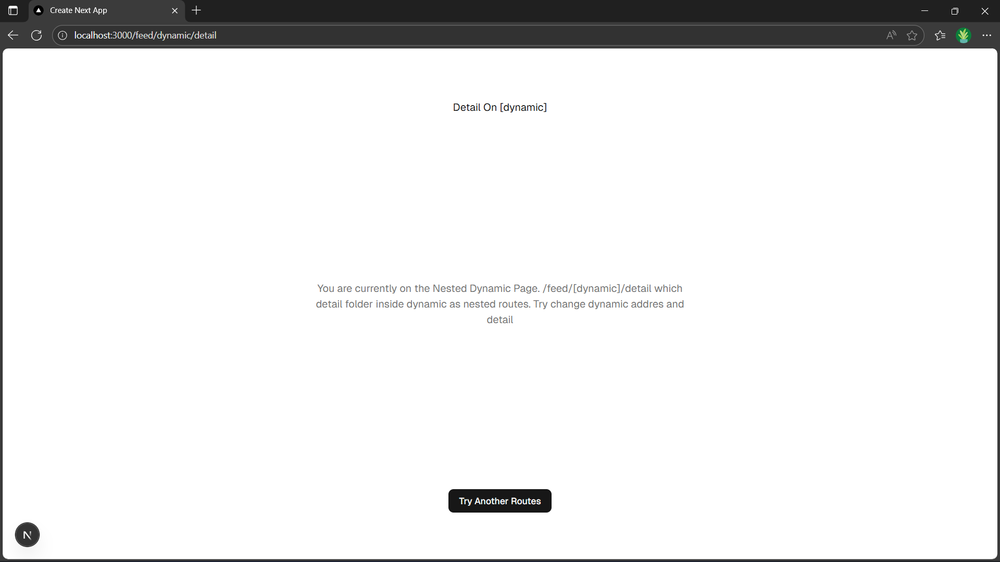
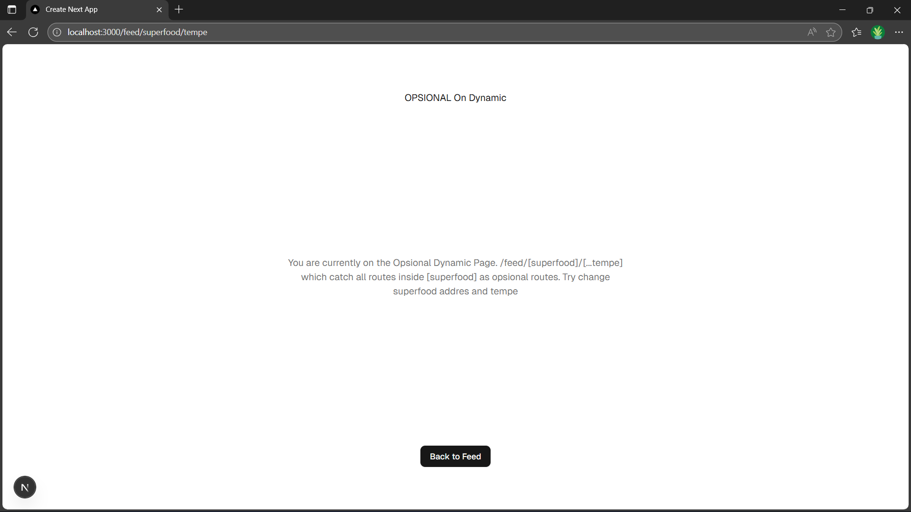
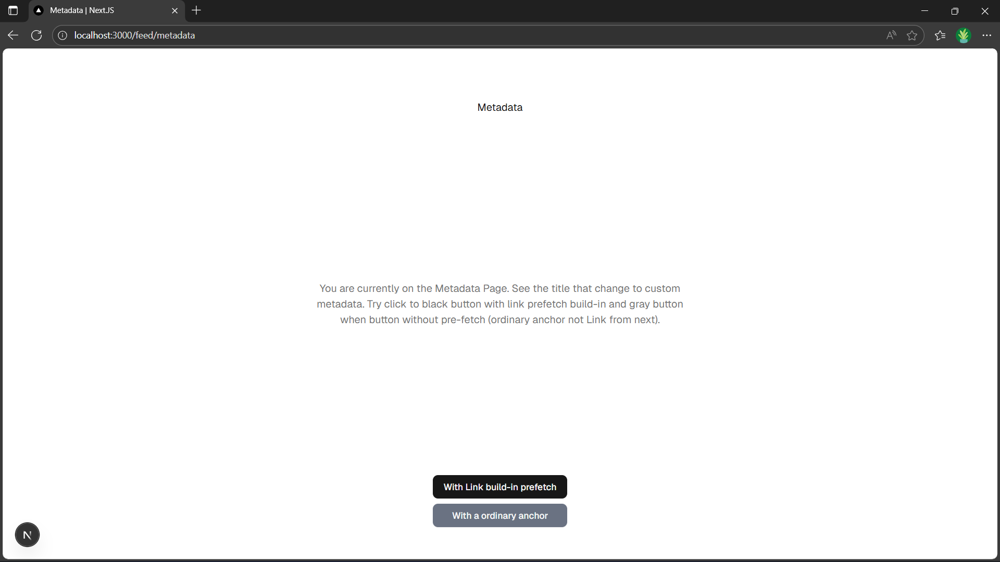

<a id="top"></a>

# Next.JS Advanced Routing, Metadata & Middleware

A Next.js project with **nested & dynamic routing**, **client-side navigation with prefetch control**, **programmatic redirects**, **route protection via middleware**, and **custom metadata**.  
Built with Husky for Git hooks and Shadcn UI for a clean, modern interface.

---
## ✨ Features  
- 🧭 **Advanced Routing** – Supports nested routes, dynamic routes with parameters, and optional segments. You can also group routes or create private folders that are excluded from the routing system.  
- 🔗 **Client-Side Navigation** – Smooth navigation using Next.js `Link`, which includes built-in prefetch for faster page loads and avoids full page reloads compared to regular `<a>` tags.  
- 🔄 **Redirects & Programmatic Navigation** – Dynamically navigate or redirect users using the Next.js navigation API for better UX.  
- 🛡 **Middleware Protection** – Secure your application by restricting access to specific routes through custom middleware logic.  
- 🏷 **Custom Metadata** – Easily define SEO-friendly metadata for each page, with support for dynamically generated metadata.  
- 🎨 **Modern UI** – Designed with Shadcn UI and Tailwind CSS, providing a clean, customizable, and responsive interface.  
- ⚡ **Fast Development** – Powered by Bun for ultra-fast dependency installation and development server startup.  
- 🔧 **Git Workflow Automation** – Integrated Husky, lint-staged, and commitlint to enforce consistent commit messages and maintain code quality.  

## 🛠️ Built With  
- **Next.js (App Router)** – React framework with advanced routing & server components.  
- **React** – Declarative UI library.  
- **TypeScript** – Strongly typed JavaScript for safer code.  
- **Shadcn UI** – Accessible, customizable component library.  
- **Tailwind CSS** – Utility-first CSS for rapid styling.  
- **Bun** – Modern JavaScript runtime for speed.  
- **Husky** – Automates Git hooks for pre-commit checks.  
- **ESLint + Prettier** – Ensures code consistency and formatting.  


## 📷 Screenshot

### Initial View Dekstop


### Routing Page /login


### Nested Routing Page


### Opsional Dynamic Routing Page


### Metadata Page


<p style="text-align: center; margin-top: 20px;">
  <a href="#top">⬆️ Back to Top</a>
</p>

___
## 🚀 Getting Started

### Install dependencies
```bash
bun install
```

### Run the development server
```bash
bun dev
```

### Run the production build
```bash
bun build
bun start
```
---

## Project Structure

```ts
└── 📁docs   // Documentation directory
    └── 📁images   // Images for docs
        ├── 01-initial-dekstop-view.png
        ├── 02-routing-login-group-private-folder.png
        ├── 03-routing-nested-on-dynamic.png
        ├── 04-routing-opsional-dynamic.png
        └── 05-metadata.png
└── 📁public   // Public assets
    ├── file.svg
    ├── globe.svg
    ├── next.svg
    ├── vercel.svg
    └── window.svg
└── 📁src   // Main source directory
    └── 📁app   // Next.js app router
        ├── 📁(auth) //grouping folder: excluded from route
        │   ├── 📁login
        │   │   ├── 📁_component //private folder: excluded from route
        │   │   │   └── loginForm.tsx
        │   │   └── page.tsx
        │   └── 📁register
        │       └── page.tsx
        ├── 📁dashboard
        │   └── page.tsx
        ├── 📁feed
        │   ├── 📁[tag] // Single Dynamic Folder
        │   │   ├── 📁[...item] // Opsional Dynamic Folder: catch all, include parent or children of children
        │   │   │   └── page.tsx
        │   │   └── page.tsx
        │   ├── 📁detail
        │   │   └── page.tsx
        │   ├── 📁metadata
        │   │   └── page.tsx
        │   ├── 📁post
        │   │   ├── 📁nested //Nested routes
        │   │   │   └── page.tsx
        │   │   └── page.tsx
        │   └── page.tsx
        ├── favicon.ico   // Favicon
        ├── globals.css   // Global styles
        ├── layout.tsx    // Root layout
        └── page.tsx      // Home page
    └── 📁components
        └── 📁ui   // Shadcn UI components
            └── button.tsx
    └── 📁lib
        └── utils.ts      // Utility functions
├── .gitignore            // Git ignore file
├── bun.lock              // Bun lock file
├── components.json       // Shadcn Components configuration
├── eslint.config.mjs     // ESLint configuration
├── next-env.d.ts         // Next.js TypeScript env types
├── package.json          // Project configuration
├── postcss.config.mjs    // PostCSS configuration
├── README.md             // Project documentation
└── tsconfig.json         // TypeScript configuration
```

<p style="text-align: center; margin-top: 20px;">
  <a href="#top">⬆️ Back to Top</a>
</p>